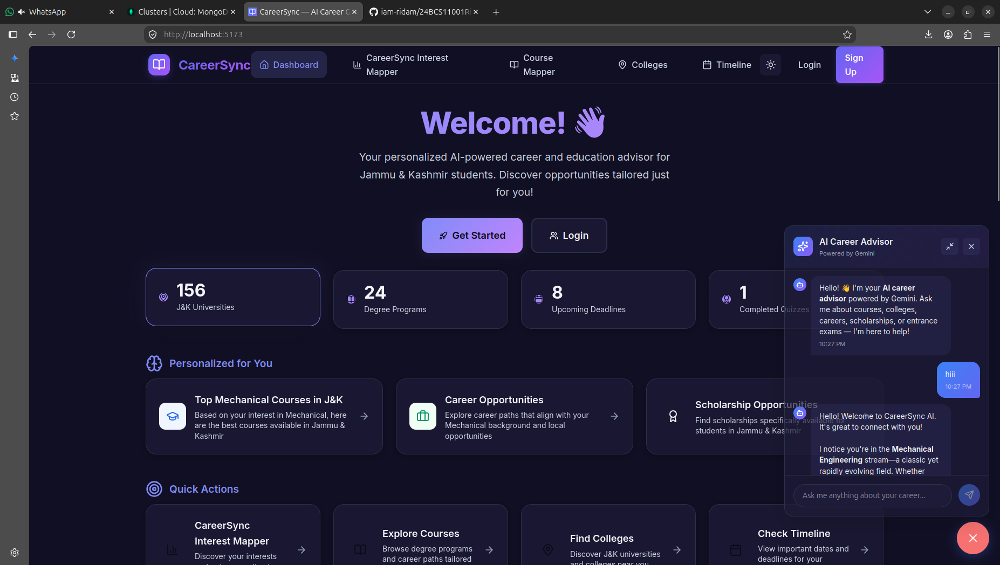
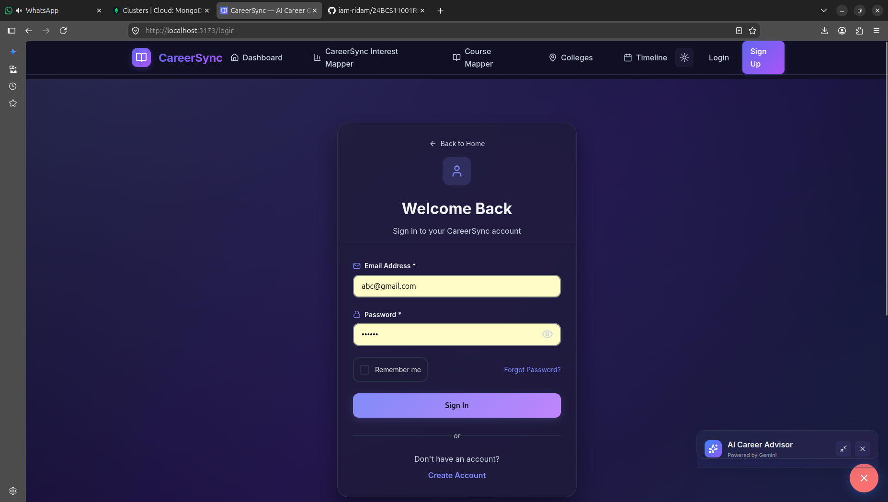
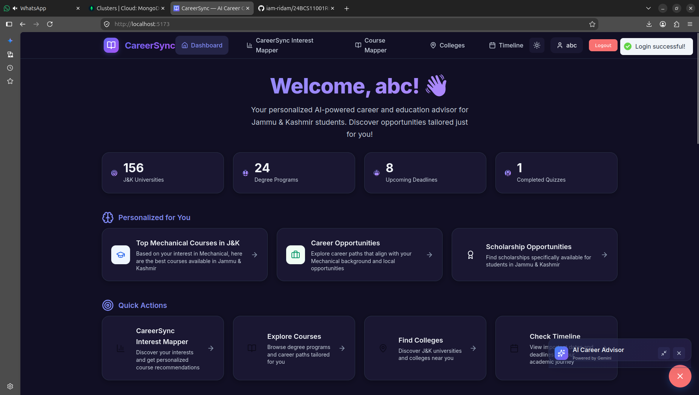
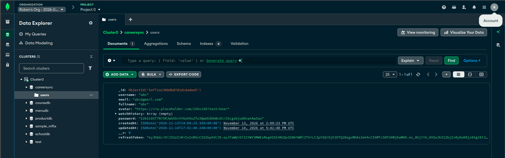

# 🎓 CareerSync - AI-Powered Career Guidance Platform


**CareerSync** is a full-stack MERN (MongoDB, Express.js, React.js, Node.js) web application designed as a comprehensive academic/college project. It delivers an AI-powered career counseling and academic exploration system to help students make informed educational decisions, choose degree streams, discover colleges, and get real-time mentorship via Google Gemini AI.

---


## 📌 Project Overview & Objectives

Many students struggle with stream selection after high school and lack accessible, personalized counseling. **CareerSync** bridges this gap by combining psychometric-style interest mapping with curated academic databases and generative AI counseling.

### Key Objectives:
- **Personalized Stream & Course Assessment**: Evaluate student interests, analytical abilities, and work-style preferences to suggest matching academic streams (Science, Commerce, Arts, Vocational).
- **Interactive Career & College Exploration**: Provide searchable directories of colleges, eligibility cut-offs, fee structures, and career roadmaps.
- **24/7 AI Career Counseling**: Integrate Google Gemini to deliver tailored conversational guidance on exams, admissions, and scholarships.
- **Secure Full-Stack Architecture**: Implement industry-standard authentication (JWT, Bcrypt, HTTP-only cookie support) and modular MVC backend design.

---


## 🚀 Key Features

- **🧠 CareerSync Interest Assessment**: An interactive multi-step quiz that analyzes student preferences and calculates personalized stream compatibility scores.
- **🗺️ Course-to-Career Roadmaps**: Detailed breakdowns of degree programs, required entrance examinations (e.g., JEE, NEET, CUET, CAT, GATE), and corresponding professional career trajectories.
- **🏫 College Directory**: Search and filter higher education institutions by location, stream, facilities, and contact details with interactive modals.
- **🤖 AI Career Advisor (Google Gemini)**: Real-time context-aware chatbot that ingests the user's academic profile and quiz results to provide tailored advice.
- **🗓️ Dynamic Academic Timeline**: Visual tracker for upcoming entrance exam schedules, admission deadlines, and scholarship applications.
- **🔒 Secure User Authentication**: Full user lifecycle management (Register, Login, Profile Update, Session Validation) secured with JWT and password encryption.

---

## 🛠️ Tech Stack & Architecture

### **MERN Architecture**
```text
┌────────────────────────────────────────────────────────┐
│                   React.js Frontend                    │
│      (Vite + Tailwind CSS + Lucide Icons + Router)     │
└───────────────────────────┬────────────────────────────┘
                            │ REST API (JSON / Cookies)
                            ▼
┌────────────────────────────────────────────────────────┐
│                  Node.js / Express API                 │
│         (Routing, Middleware, Controllers, JWT)        │
└──────────────┬───────────────────────────┬─────────────┘
               │                           │
               ▼                           ▼
┌──────────────────────────┐  ┌──────────────────────────┐
│     MongoDB (Atlas)      │  │     Google Gemini API    │
│  (Mongoose ORM Schemas)  │  │   (@google/genai SDK)    │
└──────────────────────────┘  └──────────────────────────┘
```

### **Frontend**
- **Library/Framework**: React 19 (built using Vite)
- **Styling**: Tailwind CSS & Custom CSS design tokens
- **State Management**: React Context API (`UserContext`)
- **Routing**: React Router v7
- **Icons & UI**: Lucide React, React Hot Toast

### **Backend**
- **Runtime**: Node.js (ES Modules)
- **Framework**: Express.js 5
- **Database**: MongoDB with Mongoose ODM
- **Authentication**: JSON Web Tokens (Access + Refresh tokens) & Bcrypt.js
- **AI Integration**: Google GenAI SDK (`@google/genai`) with Gemini 3.5 Flash
- **Security & Utilities**: CORS, Cookie-Parser, Helmet, Custom Error Handlers


---

## 📁 Project Directory Structure

```text
CareerSync/
├── client/                     # Frontend Application (React + Vite)
│   ├── public/                 # Static assets & favicon
│   ├── src/
│   │   ├── components/         # UI components (AIChatbot, Navbar, Directory, etc.)
│   │   ├── context/            # React Context (UserProvider, auth state)
│   │   ├── data/               # Static quiz & college dataset
│   │   ├── utils/              # API helpers (centralized fetch wrapper)
│   │   ├── App.jsx             # Route definitions
│   │   └── main.jsx            # React root mount
│   ├── .env                    # Frontend environment variables
│   ├── package.json            # Client dependencies
│   └── vite.config.js          # Vite build configuration
│
├── server/                     # Backend API (Node.js + Express)
│   ├── src/
│   │   ├── controllers/        # Request controllers (user, chat)
│   │   ├── db/                 # MongoDB database connection
│   │   ├── middlewares/        # Auth & error handling middlewares
│   │   ├── models/             # Mongoose schemas (User model)
│   │   ├── routes/             # Express API routes (/users, /chat)
│   │   ├── utils/              # ApiError, ApiResponse, AsyncHandler
│   │   ├── app.js              # Express app configuration & CORS
│   │   └── index.js            # Server entry point & DB bootstrap
│   ├── .env                    # Backend secrets & configuration
│   └── package.json            # Server dependencies
│
├── package.json                # Root package with unified dev runner (concurrently)
└── README.md                   # Project documentation
```

---

## ⚙️ Installation & Setup Guide

### Prerequisites
- [Node.js](https://nodejs.org/) (v18.x or v20.x+ recommended)
- [npm](https://www.npmjs.com/) (Node Package Manager)
- A [MongoDB Atlas](https://cloud.mongodb.com/) cluster or local MongoDB instance
- A [Google Gemini API Key](https://aistudio.google.com/)

---

### Step 1: Clone the Repository
```bash
git clone https://github.com/iam-ridam/CareerSync.git
cd CareerSync
```

---

### Step 2: Install Dependencies

You can install all dependencies across the root, backend, and frontend with:
```bash
npm install
npm --prefix server install
npm --prefix client install
```

---

### Step 3: Configure Environment Variables

#### 1. Backend Configuration
Create a `.env` file inside the `server/` directory:
```env
PORT=8000
NODE_ENV=development
MONGODB_URI=your_mongodb_connection_string
ACCESS_TOKEN_SECRET=your_jwt_access_secret_key
ACCESS_TOKEN_EXPIRY=1d
REFRESH_TOKEN_SECRET=your_jwt_refresh_secret_key
REFRESH_TOKEN_EXPIRY=10d
GEMINI_API_KEY=your_google_gemini_api_key
GEMINI_MODEL=gemini-3.5-flash
```

> **Note on MongoDB Atlas**: Ensure your current public IP is whitelisted under **Security > Network Access** in your MongoDB Atlas Dashboard (or set to `0.0.0.0/0` for development).

#### 2. Frontend Configuration
Create a `.env` file inside the `client/` directory:
```env
VITE_API_BASE_URL=http://localhost:8000/api/v1
```

---

### Step 4: Run the Application

#### Option A: Run Both Simultaneously (Recommended)
From the project root folder:
```bash
npm run dev
```
This launches:
- **Backend Server**: `http://localhost:8000`
- **Frontend Client**: `http://localhost:5173` (or next available port)

#### Option B: Run in Separate Terminals
- **Terminal 1 (Backend)**:
  ```bash
  cd server
  npm run dev
  ```
- **Terminal 2 (Frontend)**:
  ```bash
  cd client
  npm run dev
  ```

---

## 🔌 API Endpoints Reference

### **User Authentication & Profile (`/api/v1/users`)**
| Method | Endpoint | Description | Protected |
| :--- | :--- | :--- | :--- |
| `POST` | `/api/v1/users/register` | Register a new student account | No |
| `POST` | `/api/v1/users/login` | Authenticate user & issue tokens | No |
| `POST` | `/api/v1/users/logout` | Clear auth cookies & revoke session | Yes |
| `GET` | `/api/v1/users/current-user` | Retrieve authenticated user profile | Yes |
| `PATCH` | `/api/v1/users/update-account` | Update student profile & preferences | Yes |

### **AI Counseling Assistant (`/api/v1/chat`)**
| Method | Endpoint | Description | Protected |
| :--- | :--- | :--- | :--- |
| `POST` | `/api/v1/chat` | Send prompt + history + user context to Gemini | No |

---

## 🔮 Future Enhancements
- [ ] Integration of real-time mentor scheduling and 1-on-1 video consultations.
- [ ] Automated resume analysis and portfolio builder tailored for high school and college graduates.
- [ ] Community forum for peer-to-peer discussion and student reviews of academic programs.
- [ ] Multi-lingual support for regional Indian languages.

---

## 📄 Academic Project Details & License

This project was developed as a **Full-Stack MERN Academic Project** demonstrating real-world full-stack web engineering, database architecture, third-party generative AI integration, and responsive UI design.

Distributed under the [ISC License](LICENSE).
